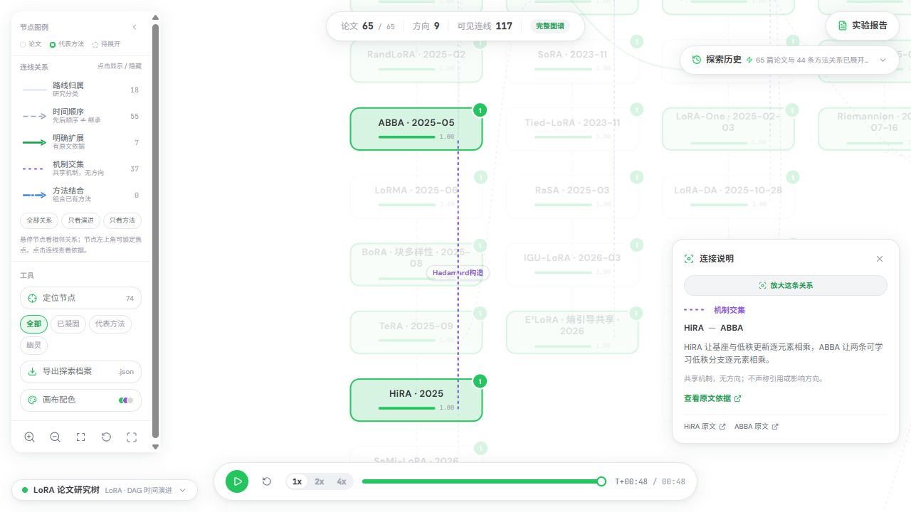

**LoRA Research Atlas** is an interactive literature map of low-rank adaptation. It connects papers by research direction and publication time, explains where methods overlap or explicitly extend earlier work, and brings their experimental results into a searchable archive.

[Explore the Research Tree](/lora-atlas/#/explore){: .btn .btn--primary} [Browse Experimental Results](/lora-atlas/#/explore/report){: .btn}

## Explore the research

- **65 papers, nine research directions** — follow the development of parameterization, rank allocation, subspaces, optimization, quantization, composition, generalization, reinforcement learning, and continual learning.
- **Explained relationships** — distinguish chronological order from explicit extensions and shared mechanisms. Filter connections, focus on a method, or open a relationship to read its explanation and original evidence.
- **Original papers one click away** — each paper node links directly to its source. Zoom, pan, search, and replay the research timeline.

## Inspect the experiments

- **632 sourced results across 132 model/configuration groups** — browse a dense results matrix or switch to a method's training and evaluation settings.
- **Conditions alongside numbers** — inspect the base model, rank, dataset, metric, split, and source table before comparing results.
- **Search, filter, and export** — filter by method, research direction, task, or model; choose dataset columns; export the selected records as CSV.

The archive contains selected experimental configurations rather than every ablation. Results retain each paper's evaluation conditions; they are not presented as a unified leaderboard. Missing entries are left blank. The bibliography was reviewed on November 14, 2026, and the experimental archive on November 17, 2026.
